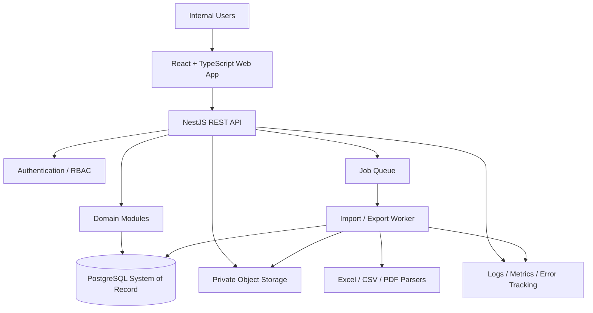

# Solution Architecture

**Architecture status:** Recommended baseline for the first release. Validate against team capability, hosting constraints and sample data before implementation.

## 1. Architecture recommendation

Use a **modular monolith**: one deployable backend application with strict domain modules, one relational system of record, a background-job worker, and private object storage. This keeps transactional consistency and delivery manageable without prematurely adding microservices. Modules should communicate through explicit application/domain services and events; do not let UI modules or database tables become unstructured cross-module integration points.

## 2. Logical architecture

## 3. Backend modules and boundaries

| Module | Owns | Must not own |
|---|---|---|
| Identity & Access | Users, roles, permissions, role assignments with per-assignment centre scope, role-conflict rules, access reviews, session/security events (see `19_RBAC_ROLE_PERMISSION_MODEL.md`) | Financial calculations |
| Approvals (maker-checker) | Shared `approval_requests` workflow and the self-approval prohibition used by charge runs, receipts, allocations, adjustments, opening balances, migrations and privileged access changes | Executing the approved action's financial logic |
| Centre Configuration | Centres, centre departments, channels, aliases, templates, commercial agreements/rules, terms | Posting receipt allocations directly |
| Import Orchestration | Upload metadata, import batch states, parsers, template mapping, staging records, validation results | Final ledger balance logic outside a posting service |
| Revenue | Validated revenue facts and report totals | Actual service-charge receipt data |
| Service-Charge Engine | Rule selection, eligible base, formulas, rounding, calculation runs and traceability | Editing posted charge entries in place |
| Receivables / Ledger | Posted receivable movements, due dates, balances, adjustments and reversals | Raw file parsing |
| Payments & Allocation | Actual receipts to operator, duplicate checks, allocation workflow | Source revenue normalization |
| Statements & Documents | Statement/invoice rendering, numbering policy, generated file metadata | Changing the underlying financial facts |
| Reporting & Analytics | Aggregations, filters, exports, metrics definitions | Maintaining a separate inconsistent copy of balances |
| Audit & Administration | Append-only events, approval logs, retention configuration | Suppressing required audit events |
| Notifications (P1) | Overdue reminders, batch completion alerts and delivery logs | Changing balances or approving finance records |

## 4. Data flow details

### 4.1 Revenue import

1. API receives file metadata and stores file in private object storage.
2. API creates import batch/file records and enqueues a job.
3. Worker validates file type and size, parses source file and writes staged rows.
4. Mapping layer normalizes department/channel names and dates into stable IDs.
5. Validation domain service computes row totals, channel sum, grand total and duplicate candidates.
6. User reviews exceptions/preview through API.
7. A backend posting service revalidates the batch in a database transaction and posts revenue and calculation/receivable entries according to the chosen posting workflow.
8. Audit/outbox records are written in the same transaction as the financial state change; asynchronous notifications are sent after commit.

### 4.2 Payment allocation

1. Record receipt in a database transaction with duplicate checks.
2. Allocate receipt to explicit open receivable items.
3. Validate total allocations against unallocated receipt amount and each item's open balance.
4. Post the credit movement(s) and allocation records atomically.
5. Recompute or query balances from authoritative posted ledger entries.
6. Create audit events and refresh reporting caches only after transaction commit.

### 4.3 Historical migration

Use the same domain services as the normal import process. A migration-only bypass that writes arbitrary balances directly to production tables is prohibited. Opening balances are explicit approved financial entries with a cutoff date and signed-off evidence.

## 5. Deployment topology

Production baseline:

- Web frontend served over HTTPS via CDN/static hosting or a secure web server.
- NestJS API container/service.
- Dedicated worker process for imports/exports.
- Managed PostgreSQL with automated encrypted backups and point-in-time recovery if supported by selected provider.
- Redis-backed queue/cache only for job processing and non-authoritative ephemeral data; Redis must never be the financial system of record.
- Private S3-compatible storage for raw files and generated documents, using short-lived signed access URLs.
- Centralized structured logs, error tracking, uptime/health checks and operational alerts.
- Separate development, test, staging and production environments with separate credentials and storage.

## 6. Architectural decisions (ADRs)

### ADR-001 — Modular monolith over microservices

**Decision:** Start as a modular monolith.  
**Reason:** Financial posting requires tight transactional boundaries. Early microservices add distributed transactions, deployment overhead and operational complexity without known scale evidence.  
**Revisit when:** independently scaling domains, separate team ownership, or measured throughput requires service extraction.

### ADR-002 — PostgreSQL as system of record

**Decision:** Use PostgreSQL for financial state and relational integrity.  
**Reason:** Transactions, foreign keys, uniqueness, decimal types, audit relationships and strong querying fit the requirements.

### ADR-003 — Backend is authoritative for all financial logic

**Decision:** Calculations and posting rules exist only in backend domain services (plus independent test reference formulas), not in frontend-only code or spreadsheets.  
**Reason:** Prevent different screens/import methods from producing different results.

### ADR-004 — Private object storage for files

**Decision:** Source uploads and exports are stored outside database rows with hashes and metadata in PostgreSQL.  
**Reason:** Better lifecycle, download controls and storage management; database retains provenance and protected file references.

### ADR-005 — Asynchronous import jobs

**Decision:** Parsing large files is asynchronous and idempotent.  
**Reason:** Avoid browser/API timeouts and support retries/progress. Final posting is a separate controlled transaction.

### ADR-006 — Append-only financial history

**Decision:** Posted financial entries are not silently edited/deleted. Use linked reversal/correction entries.  
**Reason:** Preserve auditability and explain historical balances.

### ADR-007 — Internal multi-centre model with future org boundary

**Decision:** MVP supports one operator organisation across multiple centres; data records carry organization scope where practical to ease future isolation, but public multi-tenant subscription administration is deferred.  
**Reason:** Matches confirmed user model while reducing future migration risk.

## 7. Transaction and consistency rules

- A posting operation must be atomic: either all required financial entries and audit/outbox records commit, or none do.
- Use row locking or optimistic concurrency on receipt allocations and receivable posting to prevent two users allocating the same balance at once.
- Use database uniqueness/idempotency constraints; application checks alone are insufficient.
- A balance cache or materialized view may be used only if it can be refreshed/rebuilt from immutable ledger data and monitored against the authoritative query.
- Do not execute slow PDF parsing/OCR inside a database transaction.
- Outbox/event delivery is at-least-once; consumers must be idempotent.

## 8. Observability and resilience

- Use correlation IDs across API requests, import jobs and financial posting events.
- Record job lifecycle and counts without logging confidential file content or full payment details.
- Alert on import failure rate, queue backlog, API error rate, database connection saturation, backup failures and failed reconciliation invariants.
- Provide liveness/readiness checks and controlled maintenance mode for migrations.
- Test backup restoration and document recovery point/time objectives before go-live.

## 9. Future extensions

Possible future modules include bank statement import, external centre portal, OCR, HIMS integrations, multi-organisation tenancy and notification channels. Implement interfaces and boundaries now where inexpensive, but do not build speculative services or abstractions that obscure the MVP.
