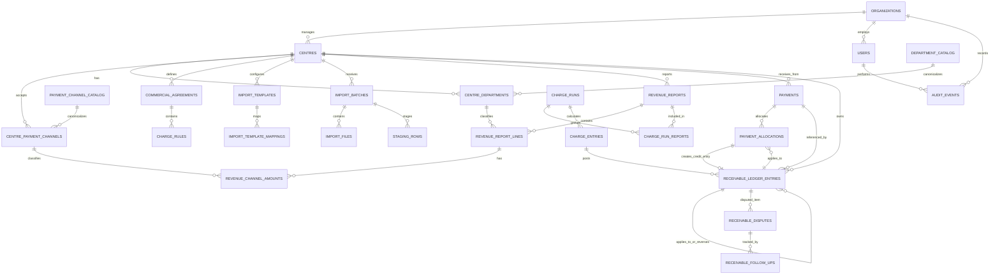

# Database Design & Schema Blueprint

**Database:** PostgreSQL (recommended)  
**Status:** Logical design baseline; DDL must be reviewed and implemented through versioned migrations. This document is not a substitute for final migration scripts and database performance testing.

## 1. Design principles

1. Use stable UUID primary keys; human-readable centre codes and report references are business identifiers, not primary keys.
2. Store monetary amounts as `NUMERIC`, never `FLOAT`/`REAL`/JavaScript `Number` for money calculations. API monetary values should be serialized as decimal strings or a documented safe representation.
3. Store percentage/rate with sufficient precision (for example `NUMERIC(9,6)`); the permitted range and precision require validation.
4. Store financial currency explicitly (default NGN in the UI; multi-currency handling is an open decision). Do not combine currencies in an aggregate without conversion policy.
5. All important records include `created_at`, `created_by`, and, where appropriate, `updated_at`, `updated_by`, status and version.
6. A posted/immutable record cannot be hard-deleted through the application. Foreign-key restrictions protect records referenced by finance entries.
7. Store timestamps as `TIMESTAMPTZ` in UTC; store business-effective/reporting dates as `DATE` where they represent calendar dates. Apply an agreed business timezone for reporting cutoffs.
8. Maintain both raw source labels/rows and normalized department/channel references for traceability.
9. Use append-only audit and ledger entries; a current balance may be derived or cached but must be reproducible from posted entries.
10. `organization_id` is the current operator scope and future isolation boundary; centre-level scope is enforced in authorization queries.

## 2. Logical entity relationship diagram



The diagram conveys conceptual relationships; the final schema may use additional source/link tables to avoid circular foreign-key creation order.

## 3. Core table inventory

### Organization, user and centre

- `organizations`: current operator; future tenant boundary.
- `users`: application identity subject, status and profile metadata. Credentials are handled by an identity provider where possible, not stored as raw passwords in this table.
- `permissions`, `roles`, `role_permissions`, `user_role_assignments`, `user_role_assignment_centres`, `role_conflict_rules`, `access_reviews`: RBAC. The authoritative DDL and rules are in `19_RBAC_ROLE_PERMISSION_MODEL.md` §11; assignments carry their own centre scope. Privileged role/permission/assignment changes use the shared `approval_requests` workflow below (no separate parallel approval table).
- `centres`: managed centre, code, name, timezone, currency, status and lifecycle metadata.
- `department_catalog`: optional canonical taxonomy of service departments.
- `centre_departments`: department configuration as it exists for a centre, including centre-local code/name, canonical link, active dates and status.
- `department_aliases`: source names recognized for a centre/department.
- `payment_channel_catalog`: standard channel types, e.g., Cash, POS, EFT.
- `centre_payment_channels`: channels used in a centre's reports and centre-local code/label.
- `payment_channel_aliases`: centre-specific source heading aliases.

### Agreements and rules

- `commercial_agreements`: agreement identifier, centre, effective dates, status, source/evidence reference and approval metadata.
- `charge_rules`: agreement, scope, department/channel selectors, rate, eligibility/exemption, calculation basis, rounding method and effective dates.
- `centre_payment_terms`: versioned calculation/statement/payment due-date terms and effective dates.

### Imports and revenue facts

- `import_templates`: centre-specific template name/version and supported file type.
- `import_template_mappings`: source header/path → normalized field mapping and parsing instructions.
- `import_batches`: batch type, centre scope, status, idempotency key, file hash/metadata, counts and job state.
- `import_files`: private object key, MIME type, byte size, hash, uploaded-by and parse status.
- `staging_rows`: raw row JSON, row number, parsed fields, validation state and error codes. Retention must be governed by data retention policy.
- `revenue_reports`: validated report header, reporting date/period, source batch/file, external reference, status and control totals.
- `revenue_report_lines`: department/source row, reported total, row number, raw row link and computed channel sum/variance.
- `revenue_channel_amounts`: one amount per report line and normalized centre payment channel.

### Charge calculations and receivables

- `charge_runs`: draft/review/posted calculation batch, scope, period, rounding version and totals.
- `charge_run_reports`: many-to-many link between a charge run and included reports if a run consolidates them.
- `charge_entries`: calculation detail by relevant department/channel/rule/revenue line, with eligible base, rate, charge amount and rule snapshots.
- `receivable_ledger_entries`: immutable posted debit/credit financial events for charges, opening balances, adjustments, payment allocations and reversals. `amount` is positive and `direction` indicates DEBIT/CREDIT; document the convention that debit increases the receivable and credit decreases it. A **receivable item** is a posted DEBIT entry (charge, opening balance or debit adjustment); every CREDIT entry that settles or reduces an item references it through `applies_to_entry_id`, and every reversal references the reversed entry through `reverses_entry_id`.
- `receivable_disputes`: dispute on a receivable item (reason, raised by/at, status, outcome, resolver). Never alters ledger entries.
- `receivable_follow_ups`: follow-up/collection notes (note, contact method, next action date, author) linked to a receivable item and optionally a dispute.
- `payments`: actual service-charge money received by the operator from a centre; includes received date, amount/currency, reference, method, destination account and evidence metadata.
- `payment_allocations`: amount of a payment applied to a specific open receivable entry/item; records allocation actor/date and the generated ledger credit entry.
- `adjustments`: proposed/approved debit/credit adjustments with type, reason, evidence and linked ledger entries.
- `billing_documents`: optional statements/invoices with numbering policy, period/as-of date, status, generated object key and source scope.

### Governance and platform

- `approval_requests`: single approval mechanism for all maker-checker actions (charge runs, receipts, allocations, adjustments, opening balances, migrations, and privileged role/permission/assignment changes): action type, target type/reference, requester, approver, decision, reason and before/after summary. A database or service rule rejects `approver = requester`.
- `audit_events`: append-only action log with actor, target, centre scope, timestamp, request/job correlation ID, before/after JSON and reason.
- `outbox_events`: durable post-commit events for notifications/integrations.
- `idempotency_keys`: API/batch operation keys and stored outcome metadata to prevent duplicate processing.
- `notifications`: in-app/email notification events and delivery state when notifications are enabled.

## 4. Key relationship and constraint requirements

- Unique `(organization_id, centre_code)` for centres.
- Unique centre-local code for `centre_departments` and `centre_payment_channels`.
- Unique normalized alias per centre and alias type unless approved design permits a contextual disambiguation.
- No two active charge rules may be ambiguous for the same scope, selectors and overlapping effective dates. Enforce in service logic and, where feasible, database exclusion/unique constraints.
- Unique `(report_line_id, centre_payment_channel_id)` for normalized channel amounts.
- Import batches have an idempotency key and file hash; duplicate detection additionally compares centre, report period/reference and normalized data fingerprint.
- Every charge entry links to the calculation run, source revenue fact(s) or approved historical source, and exact rule/version or exception approval.
- Every posted receivable ledger entry links to a valid centre and source event; each correction/reversal links to the original entry.
- Payment allocations are positive and cannot over-allocate either source payment or target receivable.
- A payment allocation must belong to the same centre/currency as the payment and receivable unless an explicit cross-centre/currency settlement feature is approved.
- Posted billing documents retain line-item/source references and cannot silently change after issuance; correction uses a new version/credit note according to finance policy.
- Audit events are append-only for application roles; no update/delete grants to ordinary runtime DB credentials.

## 5. Representative PostgreSQL schema blueprint

The following is a **design illustration**, not ready-to-run production DDL. Final scripts must resolve exact FK order, enums/check constraints, authorization implementation and migration choices.

```sql
CREATE TABLE organizations (
  id UUID PRIMARY KEY,
  name TEXT NOT NULL,
  status TEXT NOT NULL CHECK (status IN ('ACTIVE','SUSPENDED')),
  created_at TIMESTAMPTZ NOT NULL DEFAULT now()
);

CREATE TABLE centres (
  id UUID PRIMARY KEY,
  organization_id UUID NOT NULL REFERENCES organizations(id),
  code TEXT NOT NULL,
  name TEXT NOT NULL,
  timezone TEXT NOT NULL DEFAULT 'Africa/Lagos',
  default_currency CHAR(3) NOT NULL DEFAULT 'NGN',
  status TEXT NOT NULL CHECK (status IN ('DRAFT','ACTIVE','SUSPENDED','ARCHIVED')),
  created_at TIMESTAMPTZ NOT NULL DEFAULT now(),
  created_by UUID NOT NULL,
  updated_at TIMESTAMPTZ NOT NULL DEFAULT now(),
  UNIQUE (organization_id, code)
);

CREATE TABLE department_catalog (
  id UUID PRIMARY KEY,
  organization_id UUID NOT NULL REFERENCES organizations(id),
  canonical_code TEXT NOT NULL,
  canonical_name TEXT NOT NULL,
  is_active BOOLEAN NOT NULL DEFAULT TRUE,
  UNIQUE (organization_id, canonical_code)
);

CREATE TABLE centre_departments (
  id UUID PRIMARY KEY,
  organization_id UUID NOT NULL REFERENCES organizations(id),
  centre_id UUID NOT NULL REFERENCES centres(id),
  catalog_department_id UUID REFERENCES department_catalog(id),
  local_code TEXT NOT NULL,
  display_name TEXT NOT NULL,
  active_from DATE,
  active_to DATE,
  status TEXT NOT NULL CHECK (status IN ('ACTIVE','INACTIVE')),
  created_at TIMESTAMPTZ NOT NULL DEFAULT now(),
  UNIQUE (centre_id, local_code),
  CHECK (active_to IS NULL OR active_from IS NULL OR active_to >= active_from)
);

CREATE TABLE payment_channel_catalog (
  id UUID PRIMARY KEY,
  organization_id UUID NOT NULL REFERENCES organizations(id),
  canonical_code TEXT NOT NULL,
  canonical_name TEXT NOT NULL,
  is_active BOOLEAN NOT NULL DEFAULT TRUE,
  UNIQUE (organization_id, canonical_code)
);

CREATE TABLE centre_payment_channels (
  id UUID PRIMARY KEY,
  organization_id UUID NOT NULL REFERENCES organizations(id),
  centre_id UUID NOT NULL REFERENCES centres(id),
  catalog_channel_id UUID REFERENCES payment_channel_catalog(id),
  local_code TEXT NOT NULL,
  display_name TEXT NOT NULL,
  status TEXT NOT NULL CHECK (status IN ('ACTIVE','INACTIVE')),
  UNIQUE (centre_id, local_code)
);

CREATE TABLE commercial_agreements (
  id UUID PRIMARY KEY,
  organization_id UUID NOT NULL REFERENCES organizations(id),
  centre_id UUID NOT NULL REFERENCES centres(id),
  agreement_code TEXT NOT NULL,
  effective_from DATE NOT NULL,
  effective_to DATE,
  status TEXT NOT NULL CHECK (status IN ('DRAFT','ACTIVE','SUPERSEDED','CLOSED')),
  evidence_object_key TEXT,
  approved_by UUID,
  approved_at TIMESTAMPTZ,
  created_at TIMESTAMPTZ NOT NULL DEFAULT now(),
  CHECK (effective_to IS NULL OR effective_to >= effective_from),
  UNIQUE (centre_id, agreement_code)
);

CREATE TABLE charge_rules (
  id UUID PRIMARY KEY,
  organization_id UUID NOT NULL REFERENCES organizations(id),
  agreement_id UUID NOT NULL REFERENCES commercial_agreements(id),
  scope TEXT NOT NULL CHECK (scope IN ('CENTRE','DEPARTMENT','CHANNEL','DEPARTMENT_CHANNEL')),
  department_id UUID REFERENCES centre_departments(id),
  channel_id UUID REFERENCES centre_payment_channels(id),
  is_eligible BOOLEAN NOT NULL,
  rate NUMERIC(9,6),                       -- percentage points, 0..100 (e.g. 2.5 = 2.5%)
  fixed_amount NUMERIC(20,2),              -- used only when calculation_basis = 'EXPLICIT_AMOUNT'
  calculation_basis TEXT NOT NULL CHECK (calculation_basis IN ('ELIGIBLE_REVENUE','EXPLICIT_AMOUNT')),
  effective_from DATE NOT NULL,
  effective_to DATE,
  created_at TIMESTAMPTZ NOT NULL DEFAULT now(),
  created_by UUID NOT NULL,
  CHECK ((is_eligible = FALSE)
      OR (calculation_basis = 'ELIGIBLE_REVENUE' AND rate IS NOT NULL AND fixed_amount IS NULL)
      OR (calculation_basis = 'EXPLICIT_AMOUNT' AND fixed_amount IS NOT NULL AND fixed_amount >= 0)),
  CHECK (rate IS NULL OR (rate >= 0 AND rate <= 100)),
  CHECK (effective_to IS NULL OR effective_to >= effective_from),
  CHECK ((scope = 'CENTRE' AND department_id IS NULL AND channel_id IS NULL)
      OR (scope = 'DEPARTMENT' AND department_id IS NOT NULL AND channel_id IS NULL)
      OR (scope = 'CHANNEL' AND department_id IS NULL AND channel_id IS NOT NULL)
      OR (scope = 'DEPARTMENT_CHANNEL' AND department_id IS NOT NULL AND channel_id IS NOT NULL))
);

CREATE TABLE import_batches (
  id UUID PRIMARY KEY,
  organization_id UUID NOT NULL REFERENCES organizations(id),
  centre_id UUID REFERENCES centres(id),
  batch_type TEXT NOT NULL CHECK (batch_type IN ('REVENUE_REPORT','CENTRE_DEPARTMENTS','CENTRE_PAYMENT_CHANNELS','HIST_REVENUE','HIST_CHARGES','HIST_PAYMENTS','HIST_ALLOCATIONS','HIST_ADJUSTMENTS','OPENING_BALANCES')),
  -- technical job status; canonical sequence is defined in doc 12 §3
  status TEXT NOT NULL CHECK (status IN ('CREATED','FILE_UPLOADED','PARSING','PARSED','MAPPING','VALIDATING','VALIDATION_FAILED','READY_FOR_REVIEW','APPROVED','COMMITTING','COMMITTED','CANCELLED','FAILED')),
  -- business outcome kept separate from technical status (doc 12 §3)
  business_outcome TEXT NOT NULL DEFAULT 'NONE' CHECK (business_outcome IN ('NONE','REJECTED_BY_REVIEWER','POSTED','PARTIALLY_EXCLUDED')),
  idempotency_key TEXT NOT NULL,
  initiated_by UUID NOT NULL,
  source_file_hash TEXT,
  total_rows INTEGER NOT NULL DEFAULT 0,
  valid_rows INTEGER NOT NULL DEFAULT 0,
  rejected_rows INTEGER NOT NULL DEFAULT 0,
  duplicate_rows INTEGER NOT NULL DEFAULT 0,
  created_at TIMESTAMPTZ NOT NULL DEFAULT now(),
  committed_at TIMESTAMPTZ,
  UNIQUE (organization_id, idempotency_key)
);

CREATE TABLE import_files (
  id UUID PRIMARY KEY,
  batch_id UUID NOT NULL REFERENCES import_batches(id),
  original_filename TEXT NOT NULL,
  object_key TEXT NOT NULL,
  mime_type TEXT NOT NULL,
  byte_size BIGINT NOT NULL CHECK (byte_size >= 0),
  sha256 TEXT NOT NULL,
  created_at TIMESTAMPTZ NOT NULL DEFAULT now()
);

CREATE TABLE revenue_reports (
  id UUID PRIMARY KEY,
  organization_id UUID NOT NULL REFERENCES organizations(id),
  centre_id UUID NOT NULL REFERENCES centres(id),
  import_batch_id UUID NOT NULL REFERENCES import_batches(id),
  reporting_date DATE,
  period_start DATE,
  period_end DATE,
  external_report_ref TEXT,
  currency CHAR(3) NOT NULL DEFAULT 'NGN',
  reported_grand_total NUMERIC(20,2),
  computed_grand_total NUMERIC(20,2),
  status TEXT NOT NULL CHECK (status IN ('DRAFT','VALIDATED','PENDING_REVIEW','POSTED','SUPERSEDED','REVERSED')),
  source_fingerprint TEXT NOT NULL,
  created_at TIMESTAMPTZ NOT NULL DEFAULT now(),
  CHECK (period_end IS NULL OR period_start IS NULL OR period_end >= period_start)
);

CREATE TABLE revenue_report_lines (
  id UUID PRIMARY KEY,
  revenue_report_id UUID NOT NULL REFERENCES revenue_reports(id),
  department_id UUID REFERENCES centre_departments(id),
  source_row_number INTEGER NOT NULL,
  source_department_label TEXT NOT NULL,
  reported_total NUMERIC(20,2),
  computed_channel_total NUMERIC(20,2),
  variance NUMERIC(20,2),
  raw_row JSONB NOT NULL DEFAULT '{}'::jsonb,
  validation_status TEXT NOT NULL,
  UNIQUE (revenue_report_id, source_row_number)
);

CREATE TABLE revenue_channel_amounts (
  id UUID PRIMARY KEY,
  revenue_report_line_id UUID NOT NULL REFERENCES revenue_report_lines(id),
  centre_payment_channel_id UUID NOT NULL REFERENCES centre_payment_channels(id),
  source_channel_label TEXT NOT NULL,
  amount NUMERIC(20,2) NOT NULL,           -- signed: refunds/reversals may be negative under the template's explicit parser policy (doc 12 §4.3); no sign CHECK
  UNIQUE (revenue_report_line_id, centre_payment_channel_id)
);

CREATE TABLE charge_runs (
  id UUID PRIMARY KEY,
  organization_id UUID NOT NULL REFERENCES organizations(id),
  centre_id UUID NOT NULL REFERENCES centres(id),
  period_start DATE NOT NULL,
  period_end DATE NOT NULL,
  status TEXT NOT NULL CHECK (status IN ('DRAFT','CALCULATED','PENDING_APPROVAL','POSTED','SUPERSEDED','REVERSED')),
  currency CHAR(3) NOT NULL DEFAULT 'NGN',
  total_eligible_revenue NUMERIC(20,2) NOT NULL DEFAULT 0,
  total_expected_charge NUMERIC(20,2) NOT NULL DEFAULT 0,
  rounding_method TEXT NOT NULL CHECK (rounding_method IN ('LINE','DEPARTMENT','PERIOD')),  -- one method per run; confirmed D-004 default is 'LINE' (round half-up, 2 dp, once per charge line)
  rounding_policy_version TEXT NOT NULL,
  created_by UUID NOT NULL,
  posted_by UUID,
  posted_at TIMESTAMPTZ,
  created_at TIMESTAMPTZ NOT NULL DEFAULT now(),
  CHECK (period_end >= period_start)
);

CREATE TABLE charge_entries (
  id UUID PRIMARY KEY,
  charge_run_id UUID NOT NULL REFERENCES charge_runs(id),
  revenue_report_line_id UUID REFERENCES revenue_report_lines(id),
  revenue_channel_amount_id UUID REFERENCES revenue_channel_amounts(id),
  charge_rule_id UUID REFERENCES charge_rules(id),
  rule_snapshot JSONB NOT NULL,
  eligible_base_amount NUMERIC(20,2) NOT NULL,
  applied_rate NUMERIC(9,6),
  charge_amount NUMERIC(20,2) NOT NULL,
  explanation JSONB NOT NULL DEFAULT '{}'::jsonb,
  created_at TIMESTAMPTZ NOT NULL DEFAULT now()
);

CREATE TABLE payments (
  id UUID PRIMARY KEY,
  organization_id UUID NOT NULL REFERENCES organizations(id),
  centre_id UUID NOT NULL REFERENCES centres(id),
  receipt_date DATE NOT NULL,
  amount NUMERIC(20,2) NOT NULL CHECK (amount > 0),
  currency CHAR(3) NOT NULL DEFAULT 'NGN',
  payment_method TEXT,
  payment_reference TEXT,
  receiving_account_label TEXT,
  evidence_object_key TEXT,
  status TEXT NOT NULL CHECK (status IN ('DRAFT','SUBMITTED','APPROVED','POSTED','REJECTED','REVERSED','RETURNED')),
  recorded_by UUID NOT NULL,
  recorded_at TIMESTAMPTZ NOT NULL DEFAULT now(),
  submitted_by UUID,
  approved_by UUID,                        -- service/DB rule: approved_by <> recorded_by when maker-checker applies
  posted_by UUID,
  posted_at TIMESTAMPTZ
);

CREATE TABLE receivable_ledger_entries (
  id UUID PRIMARY KEY,
  organization_id UUID NOT NULL REFERENCES organizations(id),
  centre_id UUID NOT NULL REFERENCES centres(id),
  entry_type TEXT NOT NULL,
  direction TEXT NOT NULL CHECK (direction IN ('DEBIT','CREDIT')),
  amount NUMERIC(20,2) NOT NULL CHECK (amount > 0),
  currency CHAR(3) NOT NULL DEFAULT 'NGN',
  effective_date DATE NOT NULL,
  posting_date DATE NOT NULL,
  due_date DATE,
  earning_period_start DATE,
  earning_period_end DATE,
  charge_entry_id UUID REFERENCES charge_entries(id),
  payment_id UUID REFERENCES payments(id),
  source_type TEXT NOT NULL,
  source_id UUID NOT NULL,
  reverses_entry_id UUID REFERENCES receivable_ledger_entries(id),
  applies_to_entry_id UUID REFERENCES receivable_ledger_entries(id),  -- the receivable item (DEBIT) a CREDIT settles/reduces; required for CREDIT entries except reversals
  description TEXT,
  posted_by UUID NOT NULL,
  posted_at TIMESTAMPTZ NOT NULL DEFAULT now(),
  CHECK (earning_period_end IS NULL OR earning_period_start IS NULL OR earning_period_end >= earning_period_start)
);

CREATE TABLE payment_allocations (
  id UUID PRIMARY KEY,
  payment_id UUID NOT NULL REFERENCES payments(id),
  target_receivable_entry_id UUID NOT NULL REFERENCES receivable_ledger_entries(id),
  credit_ledger_entry_id UUID UNIQUE REFERENCES receivable_ledger_entries(id),
  amount NUMERIC(20,2) NOT NULL CHECK (amount > 0),
  allocated_at TIMESTAMPTZ NOT NULL DEFAULT now(),
  allocated_by UUID NOT NULL,
  status TEXT NOT NULL CHECK (status IN ('DRAFT','PENDING_APPROVAL','POSTED','REVERSED'))
);

CREATE TABLE receivable_disputes (
  id UUID PRIMARY KEY,
  organization_id UUID NOT NULL REFERENCES organizations(id),
  centre_id UUID NOT NULL REFERENCES centres(id),
  receivable_entry_id UUID NOT NULL REFERENCES receivable_ledger_entries(id),
  reason TEXT NOT NULL,
  status TEXT NOT NULL CHECK (status IN ('OPEN','UNDER_REVIEW','RESOLVED')),
  outcome TEXT CHECK (outcome IN ('UPHELD','REJECTED','SETTLED_BY_ADJUSTMENT')),
  raised_by UUID NOT NULL,
  raised_at TIMESTAMPTZ NOT NULL DEFAULT now(),
  resolved_by UUID,
  resolved_at TIMESTAMPTZ,
  CHECK (status <> 'RESOLVED' OR (outcome IS NOT NULL AND resolved_by IS NOT NULL))
);

CREATE TABLE receivable_follow_ups (
  id UUID PRIMARY KEY,
  organization_id UUID NOT NULL REFERENCES organizations(id),
  centre_id UUID NOT NULL REFERENCES centres(id),
  receivable_entry_id UUID NOT NULL REFERENCES receivable_ledger_entries(id),
  dispute_id UUID REFERENCES receivable_disputes(id),
  note TEXT NOT NULL,
  contact_method TEXT,
  next_action_date DATE,
  created_by UUID NOT NULL,
  created_at TIMESTAMPTZ NOT NULL DEFAULT now()
);

CREATE TABLE audit_events (
  id UUID PRIMARY KEY,
  organization_id UUID NOT NULL REFERENCES organizations(id),
  centre_id UUID REFERENCES centres(id),   -- NULL only for global (non-centre) events; required for centre-scoped audit queries
  actor_user_id UUID,
  action TEXT NOT NULL,
  target_type TEXT NOT NULL,
  target_id UUID,
  reason TEXT,
  before_state JSONB,
  after_state JSONB,
  correlation_id TEXT,
  created_at TIMESTAMPTZ NOT NULL DEFAULT now()
);

CREATE INDEX idx_revenue_reports_centre_date ON revenue_reports (centre_id, reporting_date);
CREATE INDEX idx_revenue_lines_report ON revenue_report_lines (revenue_report_id);
CREATE INDEX idx_charge_runs_centre_period ON charge_runs (centre_id, period_start, period_end);
CREATE INDEX idx_ledger_centre_posting ON receivable_ledger_entries (centre_id, posting_date);
CREATE INDEX idx_ledger_centre_due ON receivable_ledger_entries (centre_id, due_date) WHERE due_date IS NOT NULL;
CREATE INDEX idx_payments_centre_date ON payments (centre_id, receipt_date);
CREATE INDEX idx_audit_target ON audit_events (target_type, target_id, created_at DESC);
CREATE INDEX idx_audit_centre ON audit_events (centre_id, created_at DESC);
CREATE INDEX idx_ledger_applies_to ON receivable_ledger_entries (applies_to_entry_id) WHERE applies_to_entry_id IS NOT NULL;
CREATE INDEX idx_disputes_item ON receivable_disputes (receivable_entry_id);
```

## 6. Schema caveats and required production hardening

- The schema above intentionally omits some supporting tables and enumerated constraints for readability; implement role/permission tables, aliases, templates, staging, agreements/terms, approvals, statements, adjustments, outbox and idempotency records before release.
- Consider composite foreign keys that include `organization_id` to enforce tenant/organization consistency. Do not rely on application filters alone.
- Ensure a charge run cannot include the same revenue report more than once; add `charge_run_reports` with unique `(charge_run_id, revenue_report_id)`.
- Avoid ambiguous polymorphic `source_type/source_id` references for critical relationships where a concrete FK or a source-link table is practical.
- Allocation concurrency needs a transaction, locks or optimistic versioning. SQL constraints alone cannot safely enforce all aggregate allocation limits.
- Implement a posting service that creates the debit charge entry, allocation record and corresponding credit ledger movement in one transaction. Avoid circular-reference insertion problems by using a deliberate schema/transaction strategy.
- Add exclusion constraints or transaction-safe service validation for overlapping effective dates. PostgreSQL range types may help where suitable.
- Add `deleted_at` only for non-financial soft-deactivation use cases; avoid using soft-delete as a way to hide posted finance records.
- Partitioning is not required initially; measure volume before partitioning audit or staging tables.
- Use database roles: migrations role, runtime role with least privilege, read-only reporting role, and tightly controlled break-glass role. Runtime must not have arbitrary DELETE privileges on audit/posted ledger tables.

## 7. Balance computation convention

Recommended convention: `DEBIT` increases receivable and `CREDIT` decreases receivable. Open balance is the sum of posted debits minus posted credits for a centre/currency and relevant receivable grouping, with reversals represented by equal-and-opposite linked entries. The open balance of a single **receivable item** (a DEBIT entry) is its amount minus all CREDIT entries whose `applies_to_entry_id` points to it, plus any reversals of those credits; ageing and due status are computed per item. A CREDIT adjustment must name the item it reduces; a credit that cannot be tied to an item is reported as an unapplied credit and never netted silently. A posted payment receipt is a cash receipt record; only its allocated amount creates a credit to a particular receivable. Unallocated cash must be reported separately. If the business chooses to formally represent customer advances as credit balances, implement that as an explicit liability/credit model, not an accidental negative receivable.

## 8. Migrations and seed data

- Use versioned Prisma migrations reviewed in code review; never mutate production schema ad hoc.
- Seed standard payment-channel catalogue records (Cash, Cheque, POS, EFT, Mobile Money, eWALLET, oWallet, BANK3D) as editable catalogue entries, not immutable assumptions.
- Seed department catalogue only from approved master data; screenshot examples are not exhaustive.
- Seed roles/permissions explicitly and test them.
- Never seed fake financial records into production.

## 9. Implemented schema (Prisma) and differences from this blueprint

The backend schema is `Backend/prisma/schema.prisma` with migrations `init`, `charge_rule_channels`, `integrity_hardening` and `payments_lifecycle`. It is a smaller model than the blueprint above: organisation, users/roles/permissions/assignments/refresh sessions, centres, departments and channels with aliases, agreements and charge rules, import batches (rows stored as JSON), revenue reports and lines, charge runs and lines, receivables, ledger entries, payments, allocations, audit events and an unused idempotency table. Differences are listed in `21_IMPLEMENTATION_STATUS.md` §6.

Integrity controls added by `20261027090000_integrity_hardening` (these live in hand-written SQL because Prisma cannot express them):

- CHECK constraints: charge-rule rate 0–100 and date order; agreement, report, run and line date order and non-negative totals; receivable `balance = originalAmount − amountPaid` with `0 ≤ amountPaid ≤ originalAmount`; ledger entry exactly one-sided (`debit > 0 XOR credit > 0`); payment amount > 0 and `0 ≤ unallocatedAmount ≤ amount`; allocation amount > 0.
- Exclusion constraint `ChargeRule_no_overlap`: no two active rules for the same centre/department/channel scope with overlapping inclusive date ranges (requires the `btree_gist` extension).
- Partial unique indexes on `(centreId, periodStart, periodEnd, contentFingerprint)` for ready/committed import batches and committed revenue reports (`contentFingerprint` columns added to both).
- Append-only triggers on `LedgerEntry` and `AuditEvent` (UPDATE and DELETE raise an error).
- Foreign keys on all financial tables changed from cascade/set-null to restrict, so a centre or organisation with financial records cannot be deleted.

`refresh_rotation_grace` adds `RefreshSession.rotatedAt`, set when a refresh token is exchanged; the application accepts a rotated token for 30 seconds more and never after logout or expiry.

`payments_lifecycle` adds: the receipt status set (`DRAFT`, `SUBMITTED`, `APPROVED`, `POSTED`, `REJECTED`, `REVERSED`; allocation state is derived from `unallocatedAmount`) with submitter/approver/poster/reverser columns; database checks that the approver and poster differ from the recorder and that cash is only allocated once a receipt is posted or reversed; a unique index on live receipt references per centre (case-insensitive); removal of the unique (payment, receivable) constraint so cash can be re-allocated after a reversal; allocation `allocatedById`/`reversedById`/`reversalReason`; and `Receivable.chargeRunId` (one receivable per posted charge run, P-016; earlier per-line receivables remain).

Known gaps against sections 4–7: no `applies_to_entry_id`, `direction` column, disputes, follow-ups, approval-request table, catalogues, staging rows or template tables; `Receivable.balance` is a stored value protected only by the CHECK above.
